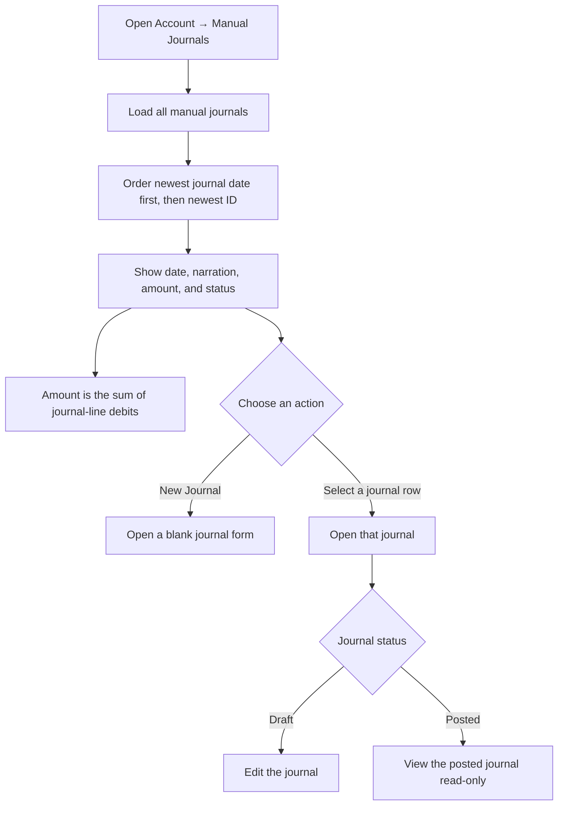
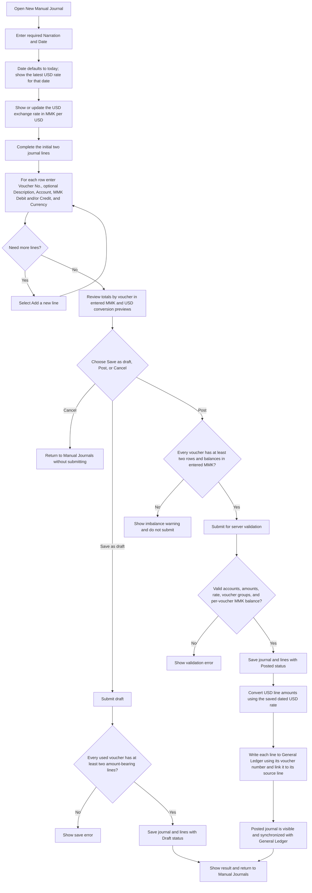
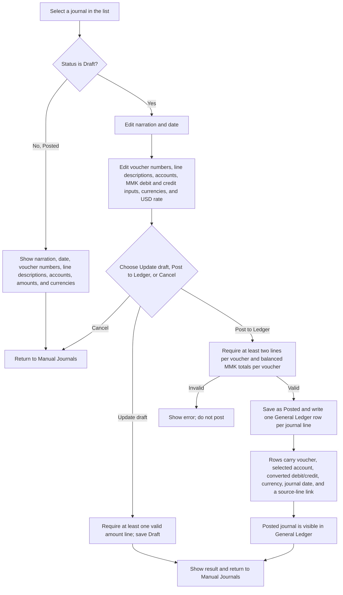

# Manual Journals — User Flow

Manual journals are accounting adjustments. The New Manual Journal page recommends that only an accountant or bookkeeper create them.

## 1. Review the journal list

## 2. Create a journal

## 3. Edit or view an existing journal

## Rules and details

- The journal list includes Draft and Posted entries, ordered by journal date descending and ID descending. Its debit total is displayed separately for each currency. Selecting a row opens its detail page. There are no visible delete or void actions.
- Narration and date are required; the date defaults to today. Each row has a voucher number, optional description, a required account selected from accounts grouped by account type, debit and credit inputs in MMK, and a currency (`MMK` or `USD`, defaulting to `MMK`). A new journal starts with two rows; **Add a new line** appends rows.
- The USD exchange-rate input is MMK per USD. It is prefilled from the latest USD rate effective on or before the journal date. Saving an entered rate creates or updates the USD rate for that date in `exchange_rates`. Each USD row stores the entered MMK amount for editing and balancing, and posts the converted amount (MMK divided by the rate, rounded to two decimals) with currency `USD`; MMK rows post the entered amount as MMK.
- The New Journal form has no remove control on its initial two rows; lines added with **Add a new line** can be removed. The edit form provides a remove control for each existing line.
- Totals update by voucher in entered MMK. Each used voucher needs at least two amount-bearing rows; posting requires debit and credit to balance to two decimals separately within every voucher. Drafts may be unbalanced.
- Drafts have no General Ledger effect. Posting changes status to Posted and creates one General Ledger row per line using that row's voucher number. Each General Ledger row links back to its manual journal line, and uses the line description as narration or the journal narration when the line description is blank.
- Draft detail can be updated as Draft or posted to the ledger. Posted journals are shown read-only in the normal page flow.
- A linked posted manual journal opened from the General Ledger uses the same form and validation rules; saving replaces its linked ledger rows and source lines together in one transaction. This editor is limited to complete, linked vouchers in the current month.
- Non-manual General Ledger vouchers continue to use their existing editor. The manual-journal editor updates the exchange rate, journal header, source lines, and linked ledger rows together.
