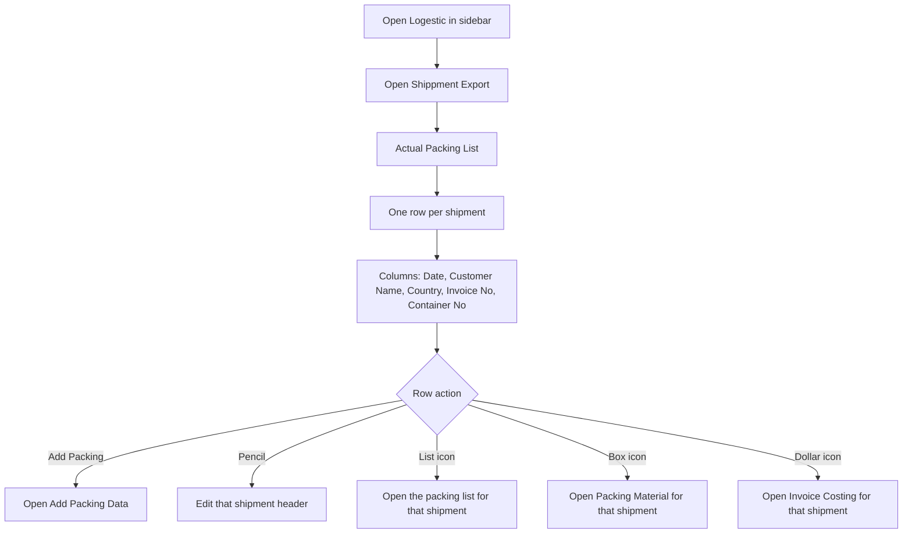
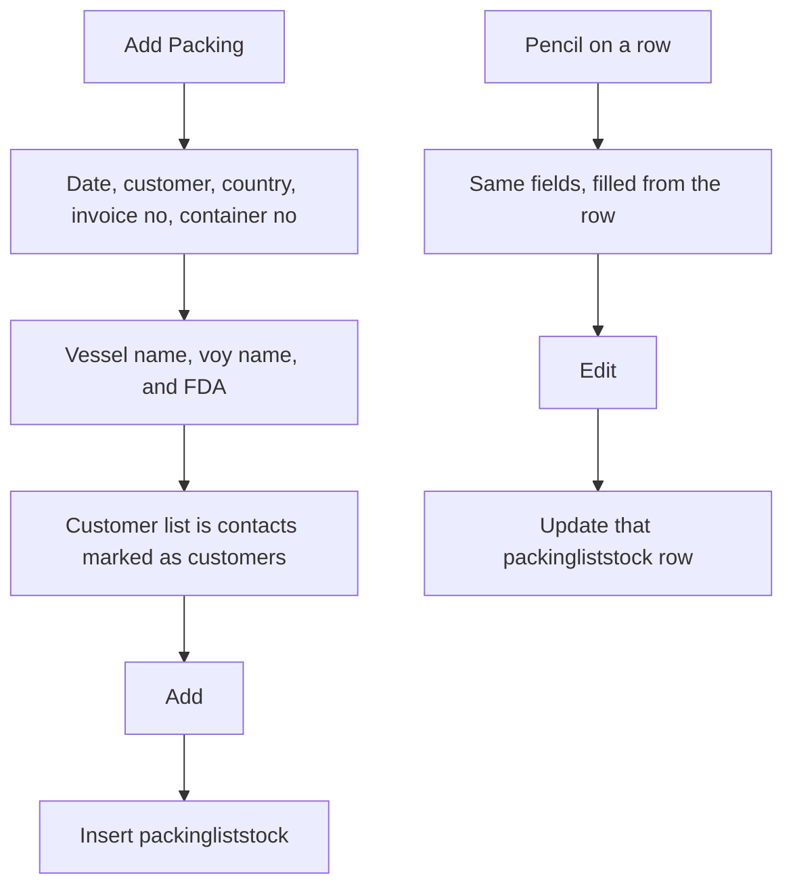
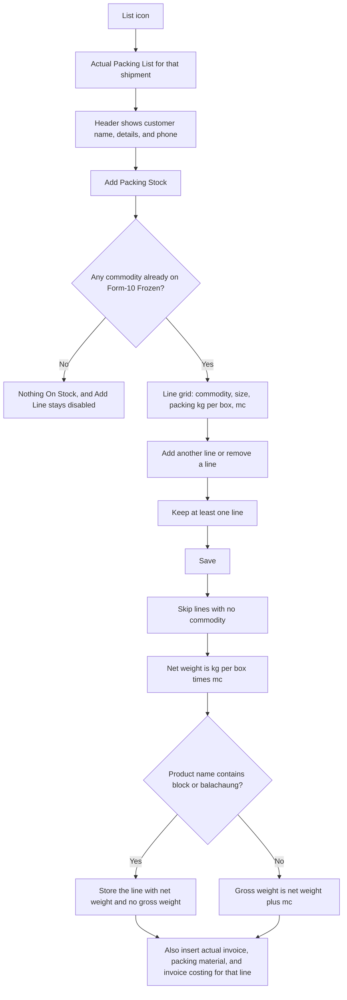
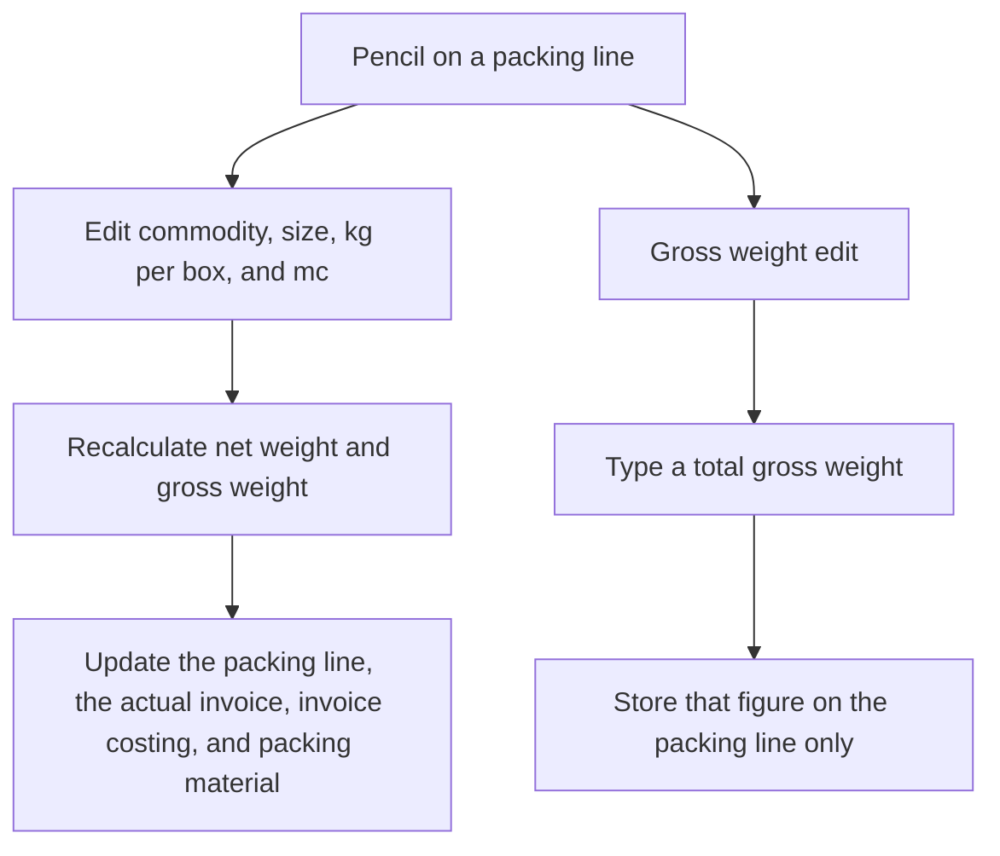
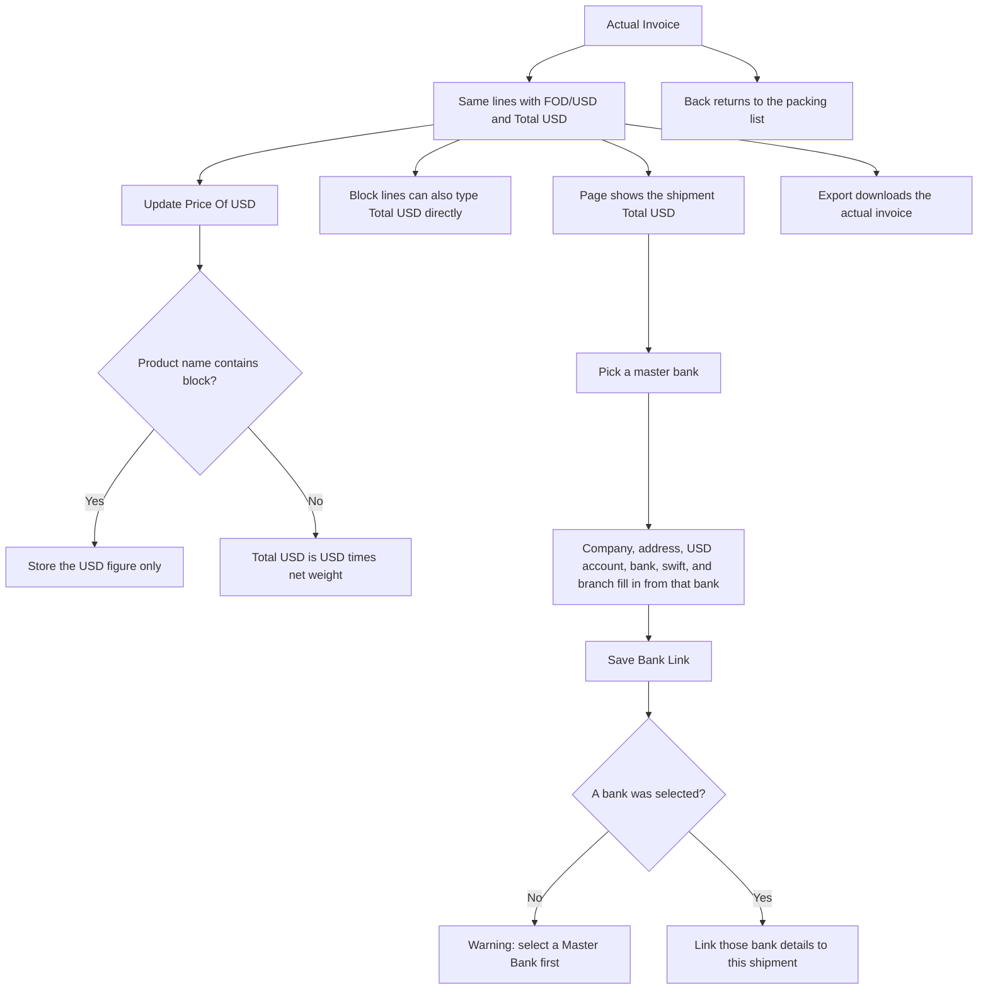

# Shipment Export — User Flow

**Access:** The **Logestic** sidebar shows **Shippment Export** to roles with the `manage_shippmentexport` permission.

Shipment Export is the sea-freight packing list in `packingliststock`. Each row is one shipment: customer, country, invoice, and container. The lines of that shipment live in `packingliststockinfo`, and adding a line also creates the actual invoice, packing material, and invoice costing rows for that shipment.

## 1. Open the shipment list

## 2. Add or edit a shipment

## 3. Add packing lines

The list columns are No, Commodity, Size, Packing Kg Per Box, Mc, Total Net Weight, and Total Gross Weight. **View** can limit the lines to one commodity. **Export** downloads this packing list.

## 4. Edit a line or its gross weight

## 5. Actual invoice and bank

**Back** on the header returns to the shipment list.

## Rules and details

- **One shipment** is one `packingliststock` row. Lines hang off it by `infoid`.
- **Commodities** on a new line come from distinct items already in Form-10 Frozen (`form10stock`). An empty list shows **Nothing On Stock**.
- **Net weight** is packing kg per box times mc. **Gross weight** is that net weight plus mc, except products whose name contains `block` or `balachaung`, which are saved without a gross weight.
- **Editing a line** rewrites the linked actual invoice, invoice costing, and packing material. A manual gross-weight edit changes only the packing line.
- **FOD/USD** times net weight is Total USD. A product whose name contains `block` stores the typed USD without that multiplication, and that line can also have Total USD typed in directly.
- **Bank link** requires a master bank. The form copies that bank's details, and they can still be edited before save.
- **No delete** of a shipment or a line from these screens.
