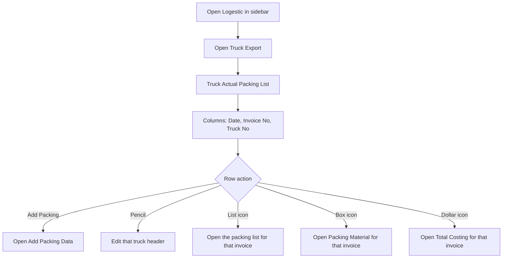
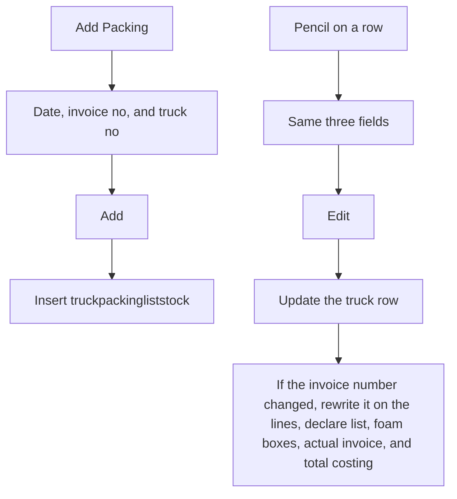
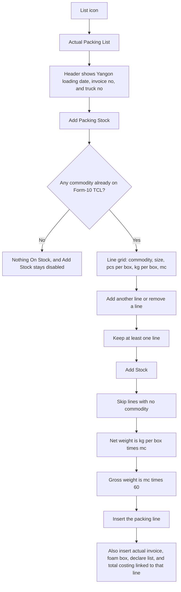
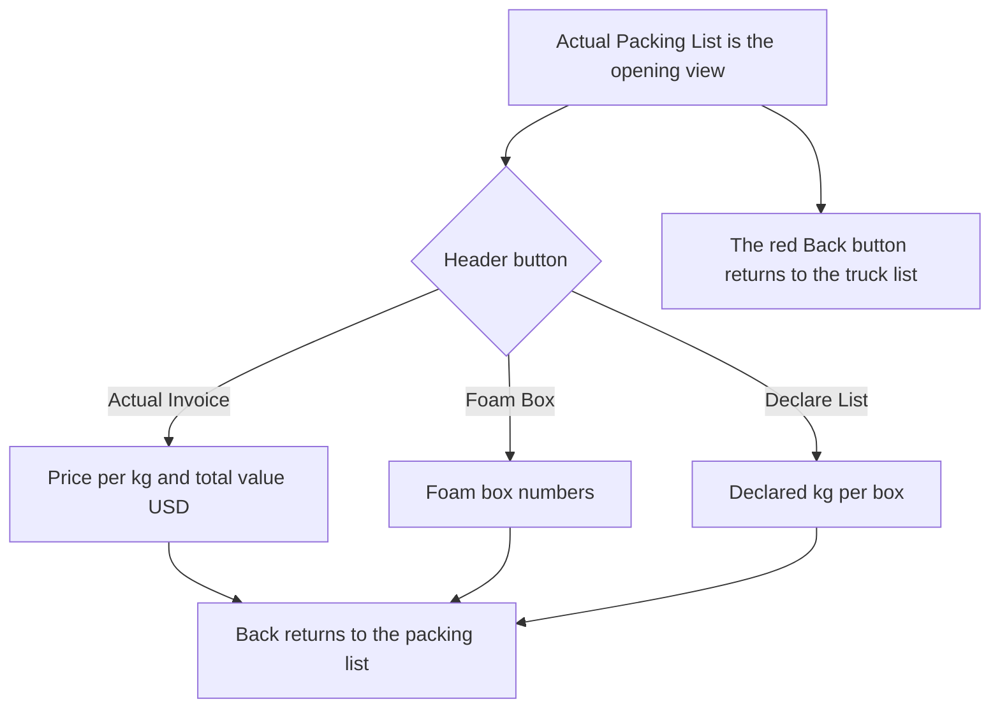
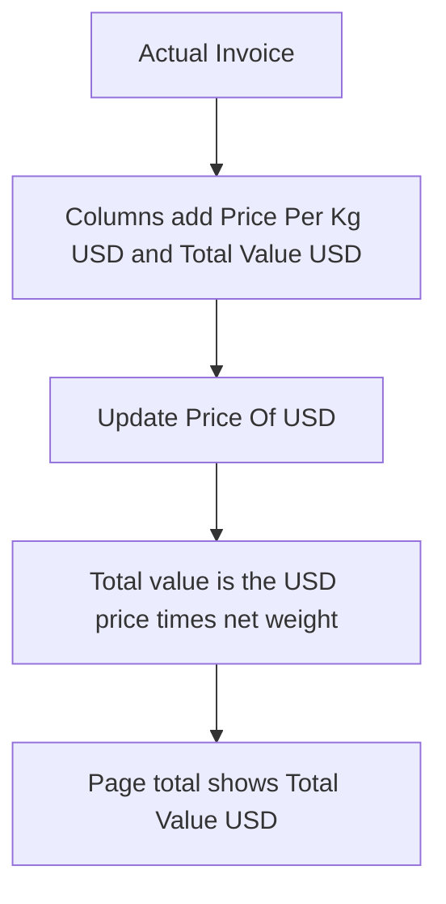
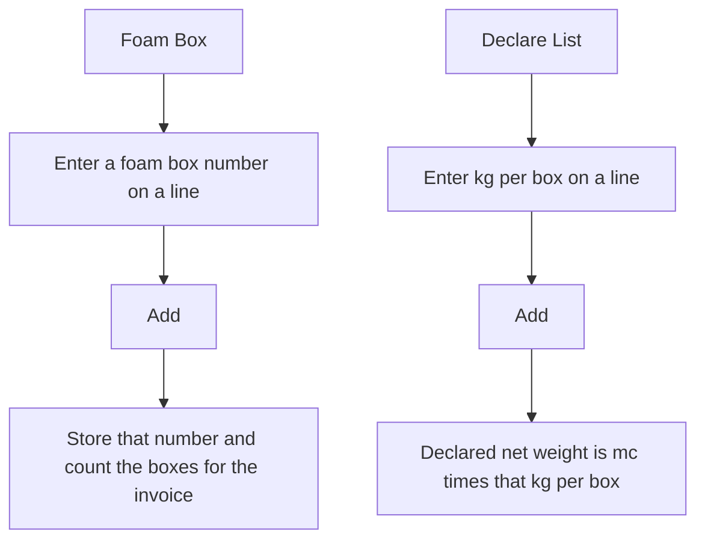

# Truck Export — User Flow

**Access:** The **Logestic** sidebar shows **Truck Export** to roles with the `manage_truckexport` permission.

Truck Export is the road-freight packing list in `truckpackingliststock`. Each row is one truck load: date, invoice number, and truck number. Adding a fish line also creates the actual invoice, foam box, declare list, and total costing rows for that invoice.

## 1. Open the truck list

## 2. Add or edit a truck

## 3. Add packing lines

The packing list columns are No, Commodity, Size, Pcs Per Box, Packing Kg Per Box, Mc, Total Net Weight, and Total Gross Weight. Totals under the table show foam boxes, net weight, and gross weight. **View** can limit the lines to one commodity. **Excel Report** on this tab exports the packing list.

A pencil on a line edits commodity, size, pcs per box, kg per box, and mc, then recalculates net and gross and updates the linked declare, foam box, invoice, and costing rows.

## 4. Switch the working view

Each of those three views has its own **Excel Report**, shown only while that view is open. **Add Packing Stock** is only on the packing list.

## 5. Actual invoice

New lines start at 0 USD until a price is entered.

## 6. Foam box and declare list

A new line is created with an empty foam box number, and with declared kg per box and declared net weight at 0, until these two screens are filled in.

## Rules and details

- **One truck load** is one `truckpackingliststock` row. Child rows share its invoice number and point back with `link_id`.
- **Changing the invoice number** on the header updates the packing lines, declare list, foam boxes, actual invoice, and total costing so they stay on the new number.
- **Commodities** come from distinct items already in Form-10 TCL (`form10stocktcl`). An empty list shows **Nothing On Stock**.
- **Packing weights.** Net weight is kg per box times mc. Gross weight is mc times 60.
- **Four records per line.** Saving a packing line also inserts `truckactualinvoice`, `truckfoambox`, `truckdeclare`, and `trucktotalcosting`. Editing the packing line updates those linked rows.
- **Declare kg** is separate from the packing kg per box. It starts at 0 and is typed later on the Declare List.
- **No delete** of a truck or a line from these screens.
