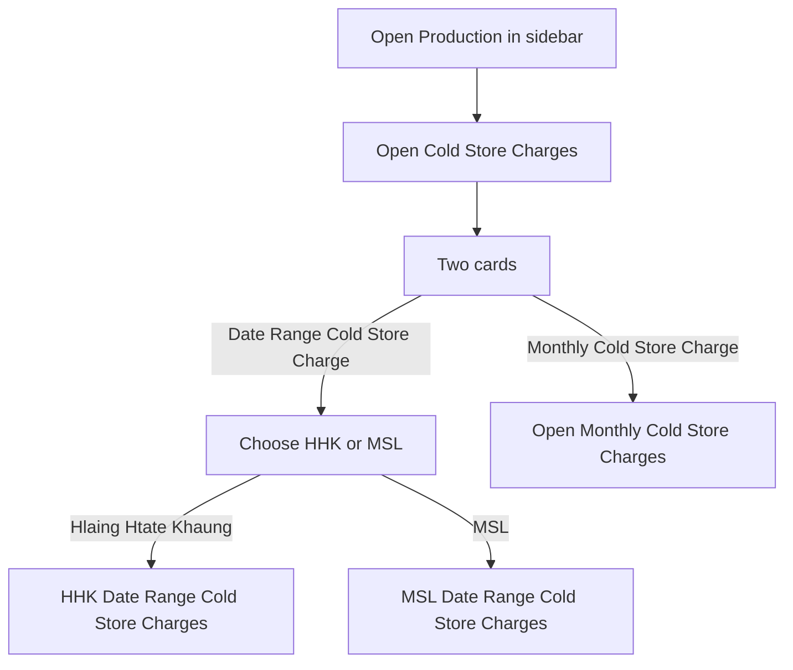
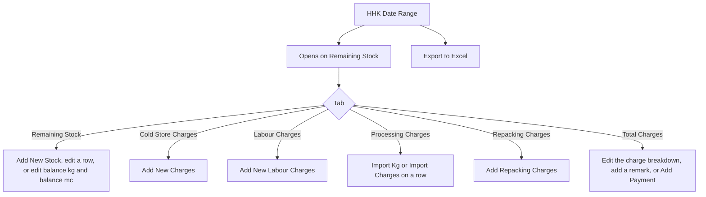
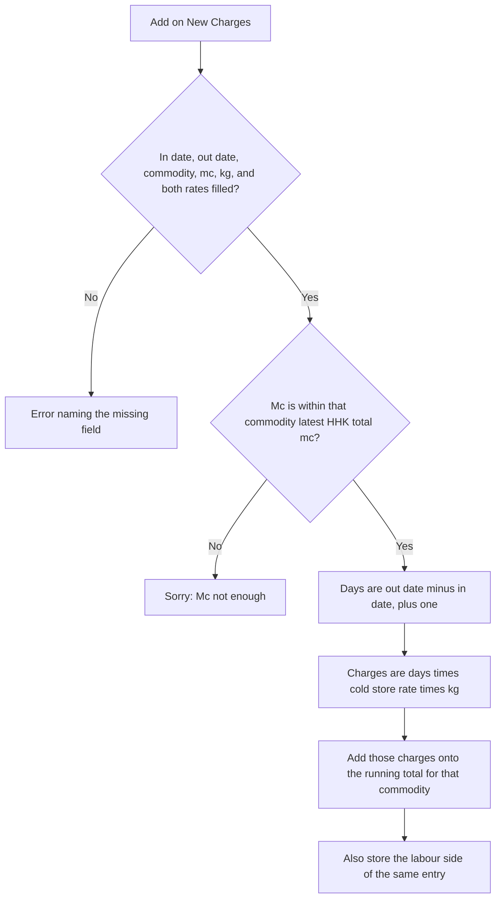
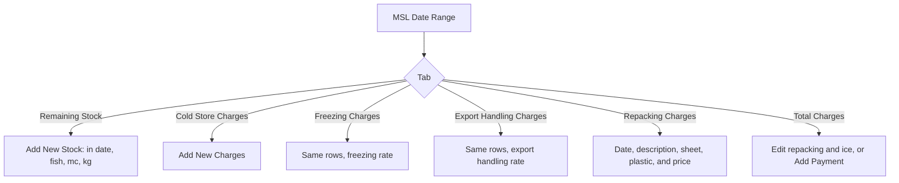
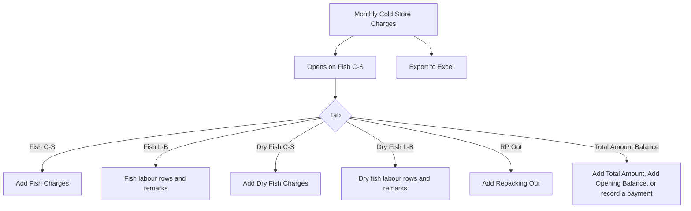
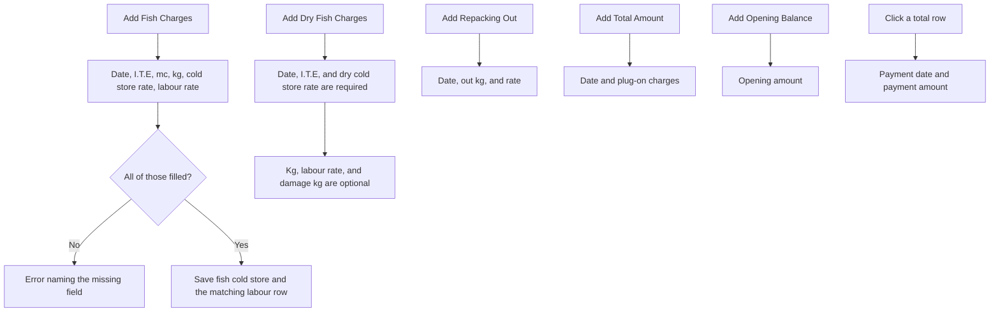

# Cold Store Charges — User Flow

**Access:** The **Production** sidebar shows **Cold Store Charges** to roles with the `manage_coldstorecharges` permission.

Cold Store Charges is the only Production screen. It splits into a **date-range** ledger (HHK and MSL) and a **monthly** GFC ledger. Rates are typed on each entry. Configuration of cold-store settings lives outside this menu.

## 1. Choose date range or monthly

## 2. HHK date range

Add New Charges asks for in date, out date, commodity, mc, kg, cold store rate, and labour rate. The commodity list is fish already on HHK stock.

A pencil on a cold-store row updates in date, out date, mc, kg, commodity, cold store rate, and labour rate. Remaining stock can be deleted after a confirm. Delete stays hidden once that stock row already has a charge.

## 3. MSL date range

New Charges takes in date, out date, fish, fish type, mc, kg, cold store rate, freezing rate, export rate, loose mc, and loose kg. A pencil updates in date, out date, mc, kg, and the three rates.

## 4. Monthly charges

Fish C-S columns are Date, I.T.E, Mc, Total Mc, Kg, Total Kg, Rate, Charges, Total Charges, Remark, and Action. I.T.E values used on the sheet are balance, import, export, and takeout.

A fish or dry-fish row can be updated or deleted. Delete asks for confirmation. Remark cells open their own edit.

The total sheet lists fish cold store, fish labour, repacking, dry-fish cold store, dry-fish labour, plug-on, total, payment date, payment amount, balance, and remark.

## Rules and details

- **Two ledgers.** Date range is split into **HHK** and **MSL**. Monthly is the GFC month sheet and is not split by those two sites.
- **HHK cold-store math.** The day count includes both the in date and the out date. Charges equal that day count times the cold store rate times kg, then add to the previous total for that commodity.
- **HHK stock check.** New charges are refused when the mc is greater than the latest `total_mc` on HHK stock for that commodity. The message is **Mc not enough**.
- **Monthly balance row.** A balance I.T.E charges the cold store rate times the kg already on hand. The first row of a new month starts the running total again. Later rows in the same month add onto it.
- **One fish entry, two sheets.** Add Fish Charges writes the cold-store row and the labour row together. Dry fish does the same with the dry cold-store rate.
- **Buttons follow the tab.** Add Fish Charges, Add Dry Fish Charges, Add Repacking Out, Add Opening Balance, and Add Total Amount are shown only on the tab they belong to.
- **Payments** sit on Total Charges for HHK and MSL, and on Total Amount Balance for the monthly sheet.
- **Excel** is on the HHK date-range page and on the monthly page.
