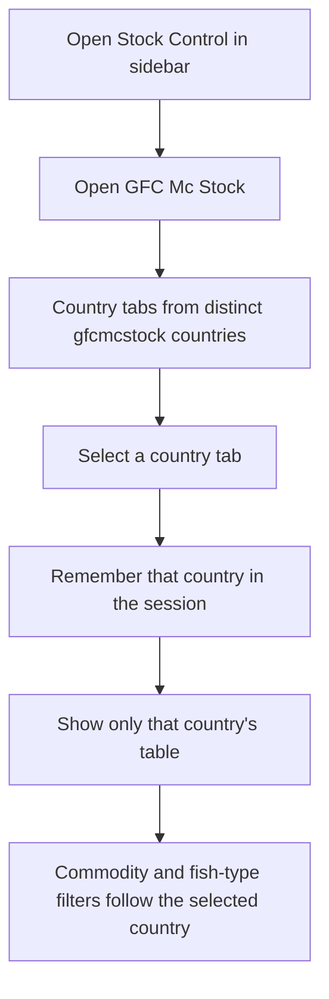
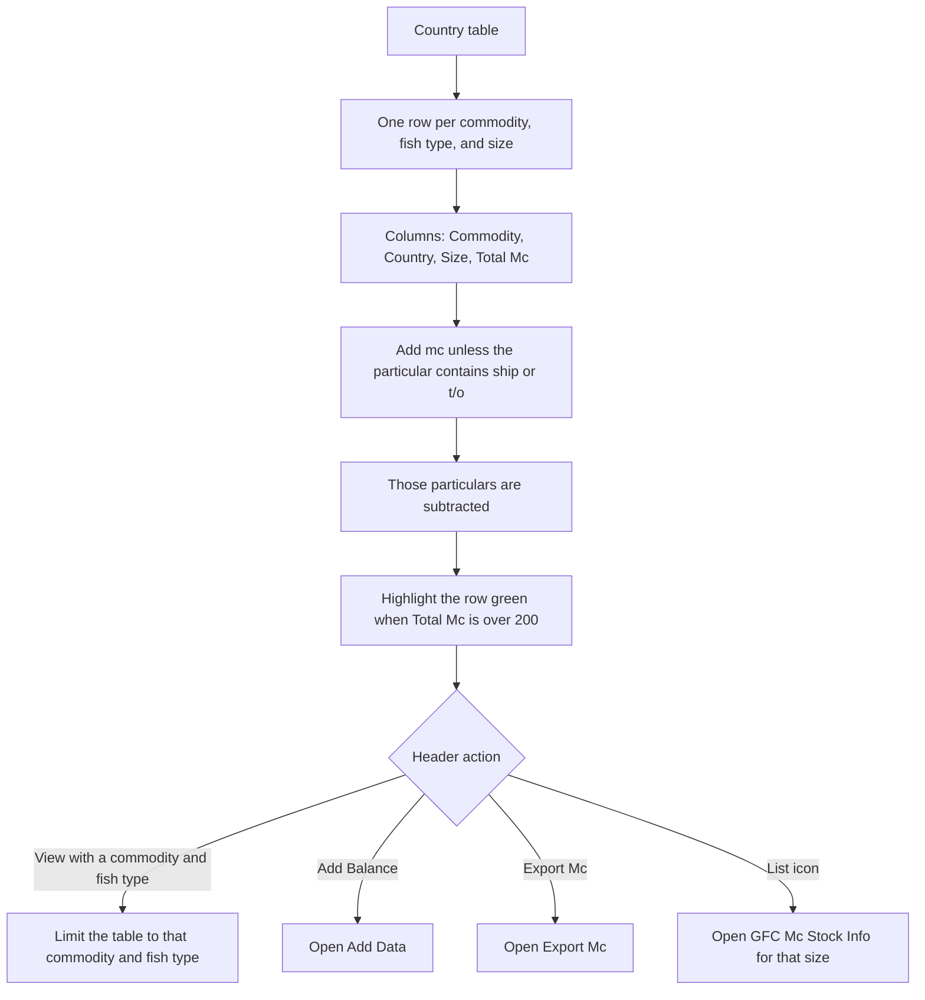
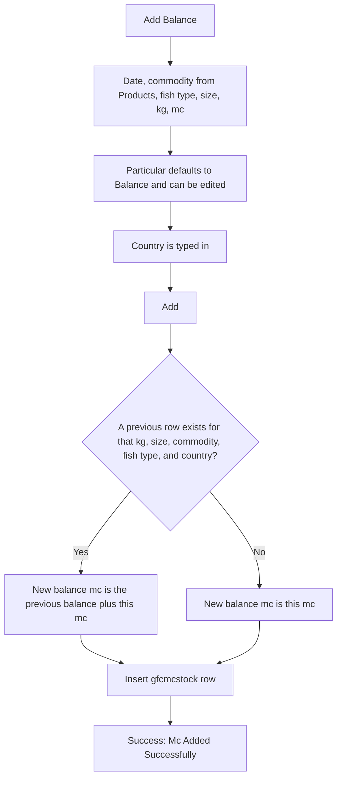
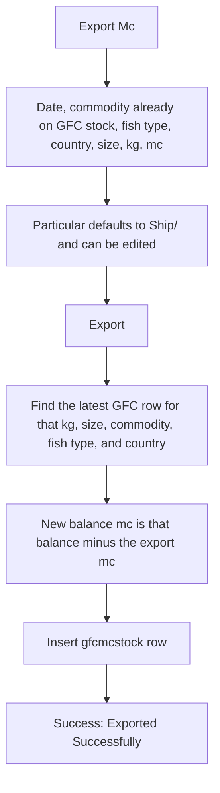
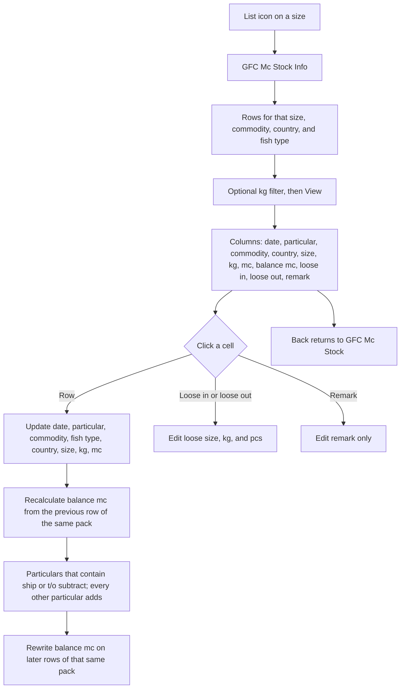

# GFC Mc Stock — User Flow

**Access:** The **Stock Control** sidebar shows **GFC Mc Stock** to roles with the `manage_gfcmcstock` permission.

GFC Mc Stock is the master-carton ledger in `gfcmcstock`. Cartons arrive from [HHK Mc Stock](./hhkMcStockUserFlowDiagram.md) when someone transfers **HHK to GFC**, or from **Add Balance** on this page. They leave through **Export Mc** (particulars that contain ship or t/o). Combined balances are read on [Mc Report](./mcReportUserFlowDiagram.md).

## 1. Open GFC Mc Stock and choose a country

## 2. Review on-hand Mc

## 3. Add a balance

## 4. Export Mc

## 5. Line detail

## Rules and details

- **List grouping** is commodity + fish type + size. Kg is not part of the list row. The info page can still filter one kg.
- **Balance math on the list** treats a particular as an issue when it contains `ship` or `t/o`. Balance, HHK to GFC, and any other wording are receipts.
- **Add Balance** stacks onto the latest `balance_mc` of the same kg, size, commodity, fish type, and country. The first row of a pack starts at the entered mc.
- **Export** always subtracts from that latest balance. The particular text is what later screens use to recognise an issue, so leaving **Ship/** in place keeps the export as an out movement.
- **HHK transfers** insert a GFC row with the same commodity, fish type, country, size, kg, and mc, and store the HHK row id in `hhk_id`. Editing that HHK row can update the linked GFC row. See [HHK Mc Stock](./hhkMcStockUserFlowDiagram.md).
- **No delete** on the list. Corrections are done from the info page.
- **Green rows** are a display hint only: Total Mc over 200.
