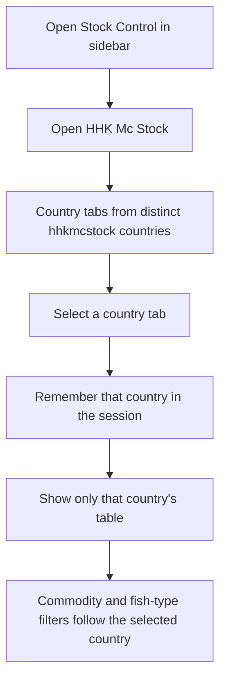
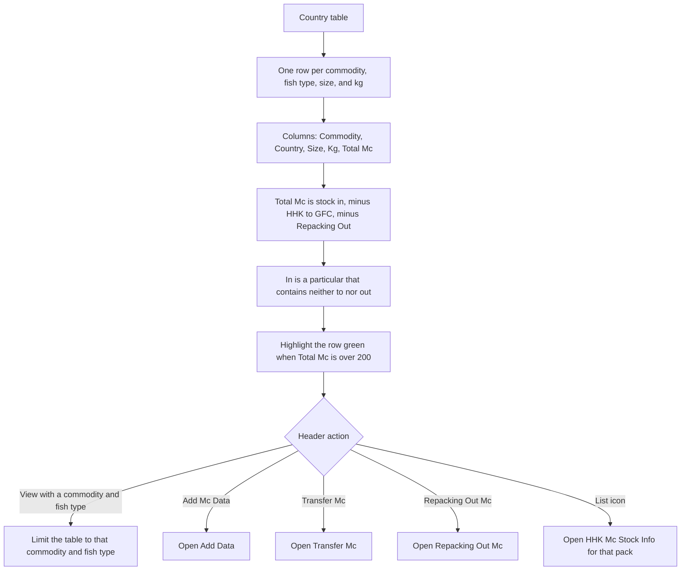
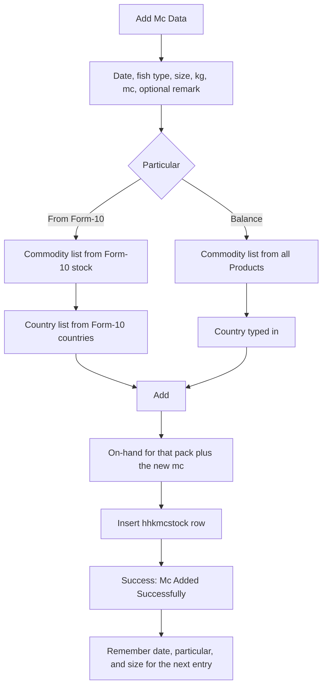
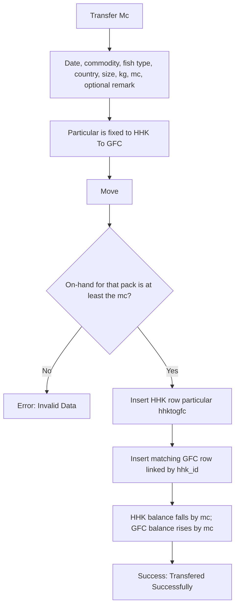
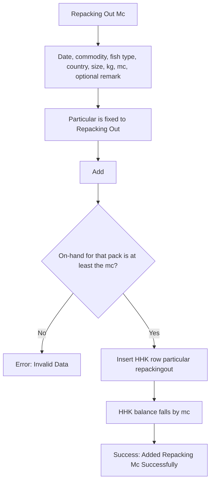
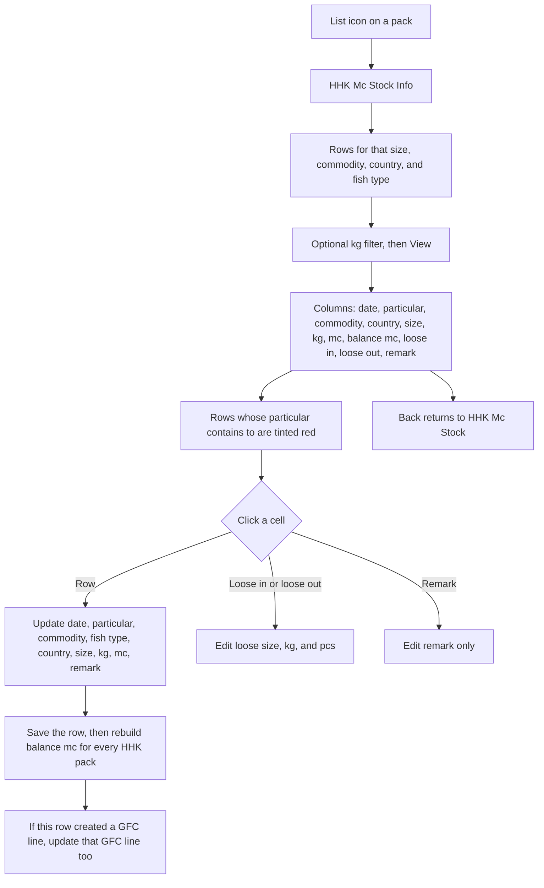

# HHK Mc Stock — User Flow

**Access:** The **Stock Control** sidebar shows **HHK Mc Stock** to roles with the `manage_hhkmcstock` permission.

HHK Mc Stock is the master-carton ledger in `hhkmcstock`. Each line is one pack: country, commodity, fish type, size, and kg. Stock comes in as **From Form-10** or **Balance**, and goes out as **HHK to GFC** or **Repacking Out**. A transfer also creates the matching row on [GFC Mc Stock](./gfcMcStockUserFlowDiagram.md). Combined HHK and GFC balances are read on [Mc Report](./mcReportUserFlowDiagram.md).

## 1. Open HHK Mc Stock and choose a country

## 2. Review on-hand Mc

## 3. Add Mc

Fish types are G, egg, ggs, fillet, W, Cut Piece, Scaless, Bl's, and IQF.

## 4. Transfer Mc to GFC

## 5. Repacking Out

## 6. Line detail

Update particulars are Repacking Out, HHK to GFC, From Form-10, and Balance.

## Rules and details

- **One pack** is country + commodity + fish type + size + kg. The list and the on-hand check both use that key, so two kg values of the same size stay separate.
- **On-hand** is the sum of mc. Particulars that contain `to` (HHK to GFC) and particulars that contain `out` (Repacking Out) are subtracted. Anything else is added. A stored balance of 0 does not by itself block a transfer when this sum is still above zero.
- **Transfer and Repacking Out** are refused when the quantity is zero or greater than that on-hand. The message is **Invalid Data**.
- **Opening the list or the info page** rewrites `balance_mc` down the ledger so each row's balance matches that running sum.
- **No delete** on the list. Corrections are done from the info page.
- **Green rows** are a display hint only: Total Mc over 200.
- **Remarks containing packing** are left out of the country list.
