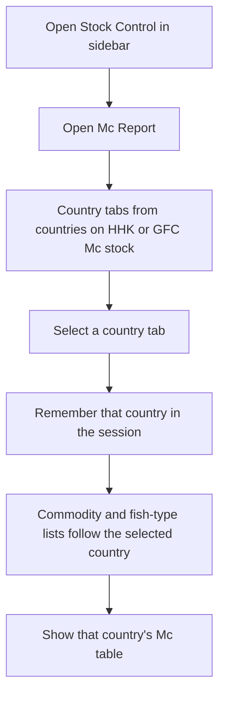
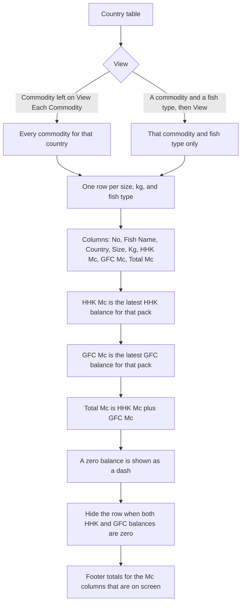
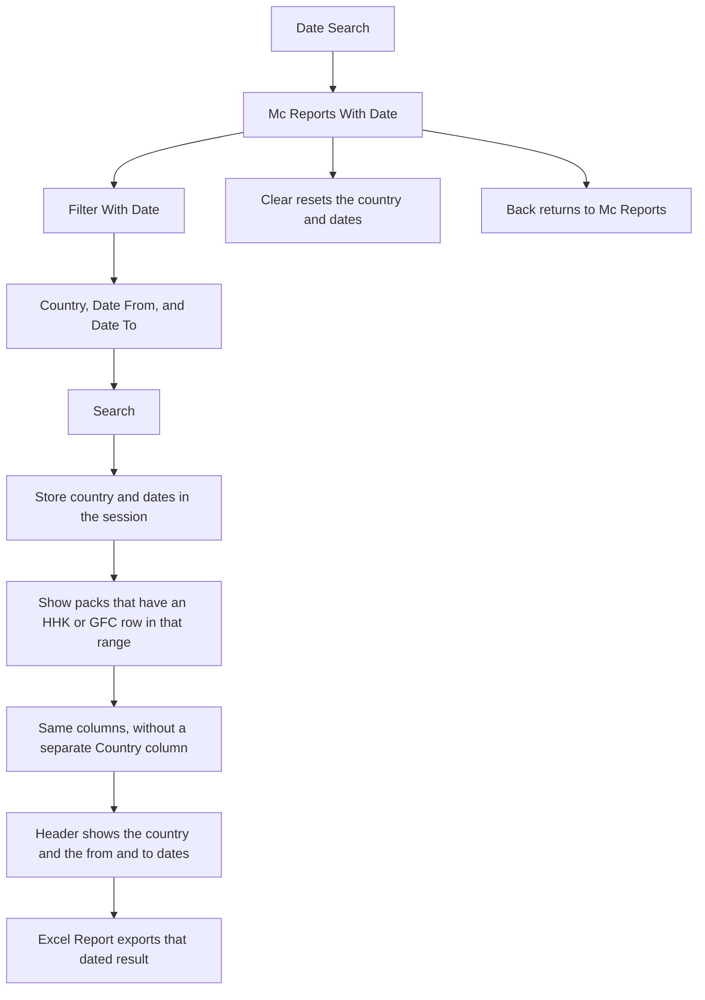
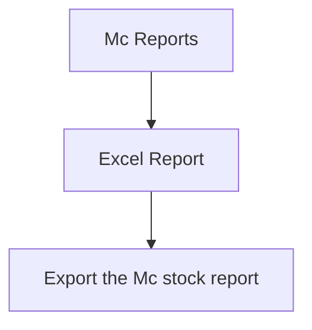

# Mc Report — User Flow

**Access:** The **Stock Control** sidebar shows **Mc Report** to roles with the `manage_mcreport` permission.

Mc Report reads the latest master-carton balance from [HHK Mc Stock](./hhkMcStockUserFlowDiagram.md) and [GFC Mc Stock](./gfcMcStockUserFlowDiagram.md). It does not include [TCL Mc Stock](./tclMcStockUserFlowDiagram.md). The same screen is also opened from **Reports → Stock Report → Mc Report**.

## 1. Open Mc Report and choose a country

## 2. Read balances

Rows used to build the list skip particulars that contain `to`, and skip remarks that contain packing. The Mc numbers themselves are still the latest stored `balance_mc`, including transfer rows.

## 3. Date search

## 4. Excel from the main report

The main Excel link does not send the commodity or fish-type filter. The dated Excel link sends the country and the from and to dates.

## Rules and details

- **Latest balance, not a movement sum.** Each Mc cell is the newest `balance_mc` for that commodity, country, fish type, size, and kg.
- **A pack with no row** on one side shows a dash for that side. Total Mc is the other side alone.
- **Both sides zero** drops the row on the main report. The dated report still lists the pack.
- **Date Search** limits which packs appear. It does not recompute a balance as of the end date; the Mc columns stay the latest stored balance.
- **TCL is not on this report.** TCL balances stay on [TCL Mc Stock](./tclMcStockUserFlowDiagram.md).
