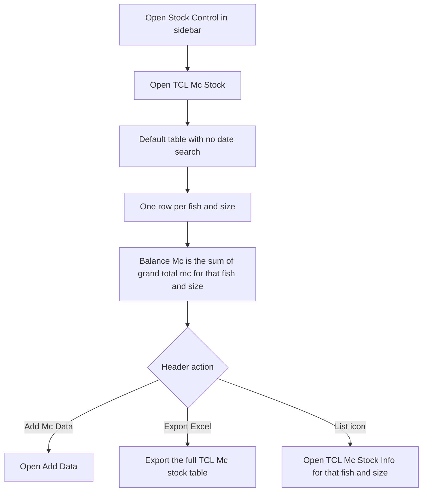
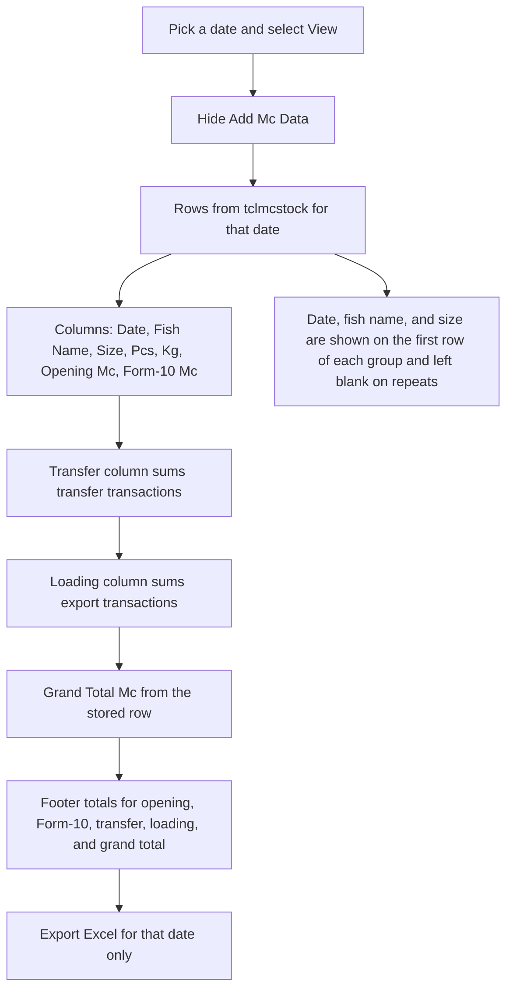
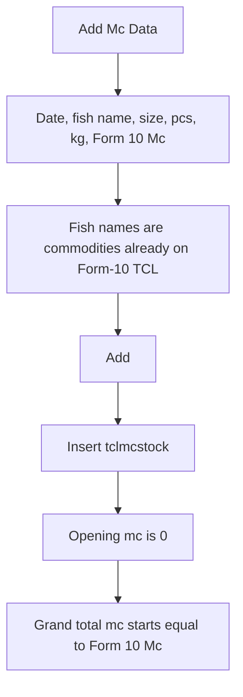
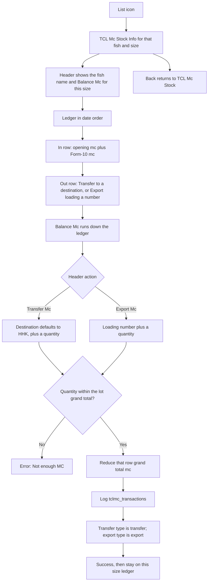

# TCL Mc Stock — User Flow

**Access:** The **Stock Control** sidebar shows **TCL Mc Stock** to roles with the `manage_tclmcstock` permission.

TCL Mc Stock records master cartons in `tclmcstock`, with outs logged in `tclmc_transactions`. It is not filled automatically when [Form-10 TCL](./form10UserFlowDiagram.md) is saved. Someone adds a Form-10 Mc quantity here, then transfers or exports it from the size ledger.

## 1. Review balance by fish and size

## 2. View one date

The transfer header reads **Transfer to** plus the first transfer destination that day. The loading header reads **Loading** plus the first export destination that day. A zero quantity is shown as a dash.

## 3. Add Form-10 Mc

Add Mc Data is only on the undated balance list. It is hidden after a date View.

## 4. Size ledger, transfer, and export

The quantity field cannot be set above the grand total of the lot that still has stock. Transfer and export use today's date on the transaction log.

## Rules and details

- **Two views.** With no date, the page is a balance list grouped by fish and size. With a date and **View**, it is a daily sheet and **Add Mc Data** is hidden.
- **Form-10 does not post here.** Commodities offered on Add are the distinct items already in `form10stocktcl`, but saving Form-10 TCL does not create a TCL Mc row.
- **Grand total on add** equals the Form-10 Mc. Opening mc is stored as 0.
- **Outs do not delete the row.** Transfer and export lower `grandtotal_mc` and append `tclmc_transactions`. The daily sheet reads those logs for the Transfer and Loading columns.
- **Not enough MC** is returned when the requested quantity is greater than that row's current grand total.
- **Excel** without a date exports the whole `tclmcstock` table. Excel after View exports that date only.
