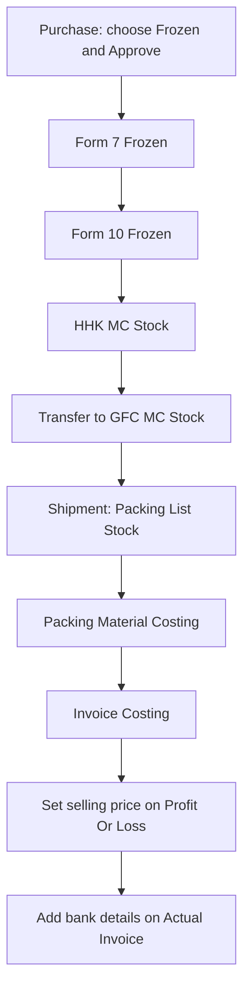

# Frozen Stock Flow

This page is the path one frozen lot takes, from the purchase through to the bank details on the invoice. It is here so a new person can see why they leave one screen and open the next.

This guide does not walk through the accounts work. After you approve the purchase, the bill does land in Payable as a payment still waiting. That is only so you know what the approve button did.

## 1. Start at Purchase

Open Purchase and start a new purchase.

- Enter the supplier name.
- Set the type to **Frozen**. TCL and Material are other purchases, not this path.
- Enter the voucher number.
- Add the fish you are buying.

You can finish the bill in two ways.

Anything under **Save** keeps the bill, and the bill is not finished. Someone still has to approve it later.

**Approve** finishes it now.

Once it is approved, the bill becomes **Awaiting Payment** and it is also inserted into Payable. That is the money side. For the stock side, open **Form 7 Frozen** under Stock Control. The menus are far apart. The fish from this purchase is waiting on that screen.

## 2. Form 7 Frozen

The size on the purchase and the size after remeasurement can differ. A lot bought as 2up can come back as 1up or 3up.

Only when there really is another size, click the original size and type the new one. That inserts a new row. If the size did not change, leave it.

After every size is in, click each empty **PCS per F-7** cell and fill it.

Then tick the rows.

- If you split sizes, tick every row that came from that split.
- If you did not split, you still tick that one row.

**Bulk Update** stays off until a row is ticked. After you tick, open it and set the country and fish type.

Click **Water Kg** only when that lot has water weight. If it does not, leave the cell alone.

Form 7 is done.

## 3. Form 10 Frozen

Form 7 does not push rows into Form 10. Not every master carton comes through. Enter only what actually arrived, with **New Form-10 Data**.

When you come back to the list, it shows Form 10 Frozen for **today**.

Two choices sit on that screen.

- To compare with Form 7, click **% Percentage**. You can pick more than one Form 7 date. Fill in the other fields and the percentage appears.
- When you are ready to ship, click **Continue to Shipment Export**. Finish the store step below before the container is loaded.

## 4. The store. HHK has to move to GFC

Put the cartons that arrived into **HHK MC Stock**. That is the Link Mark store.

The Form 10 quantity and the HHK quantity will often not match, because the full amount is not always put into the store. Do not force those two numbers to equal each other.

Nothing ships straight from HHK. Transfer the stock to **GFC MC Stock**, then ship from there.

## 5. Shipment Export

Frozen fish goes out by shipment, not by truck.

1. Click **Add Packing** and create the container. Enter the date, customer, country, invoice number, and container number.
2. Open that row and add the packing list stock.
3. Go back to the list. Open packing material on that same row and enter the packing material costing.
4. Open invoice costing on that row and enter the costing.
5. When the costing is in, call the boss. Open **Profit Or Loss**, click the row, and enter the selling price. That price is written onto the actual invoice for you. Do not type the price again on the actual invoice.
6. Last step. From the packing list stock, open **Actual Invoice** and add the bank details. Pick the bank, check the details, and save.

When the bank details are saved, this lot is finished.
