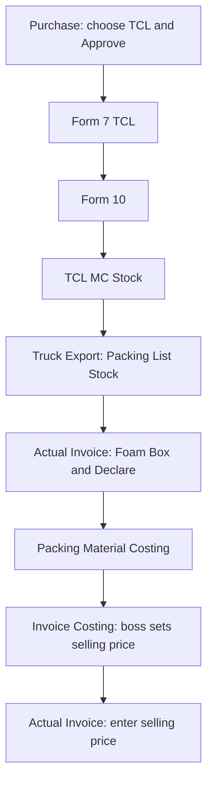

# TCL Stock Flow

This page follows a TCL purchase from Purchase through Form 7 and Form 10, into TCL MC Stock, and out through Truck Export.

This guide does not walk through the accounts work. When you approve the purchase, it also goes into Payable. That is the money side; the stock steps are below.

## 1. Start at Purchase

Open Purchase and start a new purchase.

- Enter the supplier name.
- Set the type to **TCL**.
- Enter the voucher number.
- Add the items you are buying.

You can keep the bill unfinished with **Save**, or finish it now with **Approve**. After approval, the bill goes into Payable as well. For the stock side, continue to **Form 7 TCL**.

## 2. Form 7 TCL

After the purchase, its row appears in Form 7 TCL. Open the detail feature screen to work on the rows.

If a lot has another size, click the original size and add the new size. This creates another row. If the size did not change, leave it as it is.

Select all the rows for the lot, then use **Bulk Update** to change the country. After that, fill in **PCS per F-7** for each row.

## 3. Form 10

Open Form 10 and use **Add Form-10 Data** to enter the manual data.

- Make sure the country matches the country entered in Form 7.
- Enter the quantities and details shown in the manual data.
- Do not add extra items, such as loose fish, unless they are included in the manual data.

Save the Form 10 data when it matches the manual data.

## 4. TCL MC Stock

Open **TCL MC Stock** and add the MC data for the fish. Fish names from Form 10 will be available when there is stock in Form 10.

TCL MC Stock also has a balance-adding option. That is a separate way to add stock and is not part of this flow.

## 5. Truck Export

Use **Truck Export** for this part of the TCL flow.

1. Add the **Packing List Stock**.
2. Open **Actual Invoice** and enter the **Foam Box** and **Declare** details.
3. Enter the **Packing Material Costing**.
4. Enter the **Invoice Costing**. The boss sets the selling price here.
5. Go back to **Actual Invoice** and enter the selling price after the boss has set it.

The TCL stock flow is finished once the selling price has been entered on the Actual Invoice.
